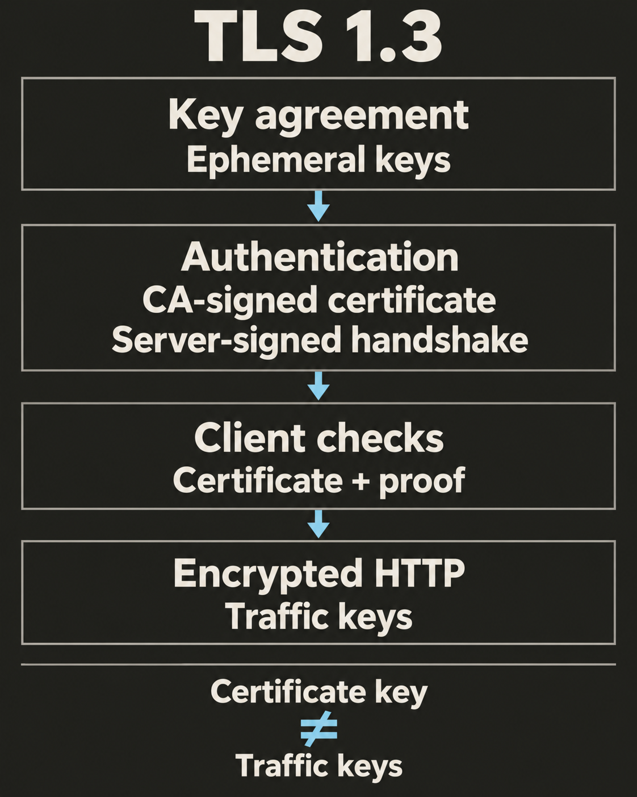

You open `https://api.example` and send an access token. Encrypting the request is useful only if the other end is really the service you intended to reach. A certificate helps the browser check that identity before it sends the token.

## Encryption needs an identity

`HTTPS` carries HTTP through a connection protected by `TLS` (Transport Layer Security). TLS provides three properties:

- `Confidentiality`: someone watching the network cannot read the protected data.
- `Integrity`: someone changing the protected data cannot do so without detection.
- `Authentication`: the client can check the identity of the server.

Consider an attacker who controls a Wi-Fi network. Without server authentication, they could establish one encrypted connection with your browser and another with the real API. They would decrypt your request, read the token, then encrypt and forward the request. Both connections could use strong encryption.

This is a `man-in-the-middle attack` (MITM). The missing check is whether the browser's encrypted connection ends at the intended service. [MDN explains these TLS protections](https://developer.mozilla.org/en-US/docs/Web/Security/Defenses/Transport_Layer_Security).

## A public document and a secret key

A server has a pair of related keys. Its `public key` can be shared. Its `private key` must stay secret. With a `digital signature`, the private key signs data and the public key verifies the signature. Verification also detects changes to the signed data.

A `certificate` is a signed document containing a public key and identity information. For HTTPS, it links the key to domain names such as `api.example`. A `certificate authority` (CA) signs the certificate with its own private key. The CA's public key allows a client to verify that signature. This is the basis of [X.509 certificates](https://www.rfc-editor.org/rfc/rfc5280.html#section-3.1).

Before issuing a domain-validated certificate, a CA checks that the applicant controls the domain. [Let's Encrypt describes this process](https://letsencrypt.org/how-it-works/).

The certificate is public. It contains no private key, and copying it gives an attacker no ability to sign as the server. The browser still needs proof that the server holds the matching private key.

The browser must also check that the certificate names the hostname it requested. A certificate for `other.example` does not authenticate `api.example`, even if its issuer is trusted. [Service Identity in TLS defines this identity check](https://www.rfc-editor.org/rfc/rfc9525.html#section-1.1).

## Where the certificate fits in TLS

The initial exchange that establishes a TLS connection is the `handshake`. Here is a simplified full TLS 1.3 handshake with certificate-based server authentication:

1. The browser and server agree on connection parameters and establish a shared secret through `key agreement`. This uses temporary key material separate from the certificate's key.
2. The server sends its certificate and supporting certificates. It also sends `CertificateVerify`, a signature covering the handshake so far, made with the server's private key.
3. The browser checks the certificate's trust, hostname, validity, and other requirements. It uses the certificate's public key to verify the handshake signature.
4. Each side verifies a `Finished` message to check the handshake and the derived keys. HTTP traffic uses symmetric traffic keys derived from the shared secret.

`Symmetric encryption` uses secret keys known to both endpoints. The certificate's key authenticates the server; it does not encrypt each HTTP request. Resumed connections can use a previously established secret without sending a new certificate. [The TLS 1.3 specification describes both flows](https://www.rfc-editor.org/info/rfc9846/).

There are two different signatures here. The CA signs the certificate when issuing it. The server signs the handshake during the connection. The first supports the identity-to-key link. The second proves possession of that key's private half in this exchange.

## What this authentication proves

A successfully checked certificate and handshake establish a connection to an endpoint authorized for the requested hostname under the client's trust rules. They do not certify that the application is honest or free of bugs. A phishing site can have a valid certificate for its own domain. [The Chromium team explains this distinction](https://blog.chromium.org/2023/05/an-update-on-lock-icon.html).

On the ordinary web, the server proves its identity through TLS. The application usually identifies users through cookies or tokens. In `mutual TLS` (mTLS), the server also requires the client to present a certificate and prove possession of its private key. [TLS supports this optional client authentication](https://www.rfc-editor.org/info/rfc9846/).

## Check your understanding

An attacker copies the API's valid certificate and sends it from their own server. They cannot access the API's private key. Can they complete the certificate-based handshake as `api.example`?

**Answer:** no. The certificate's CA signature may pass, but the attacker cannot create the required handshake signature with the matching private key. If they replace the certificate's public key with their own, the CA signature no longer verifies. The browser needs both a valid identity-to-key link and proof of possession of the private key.
