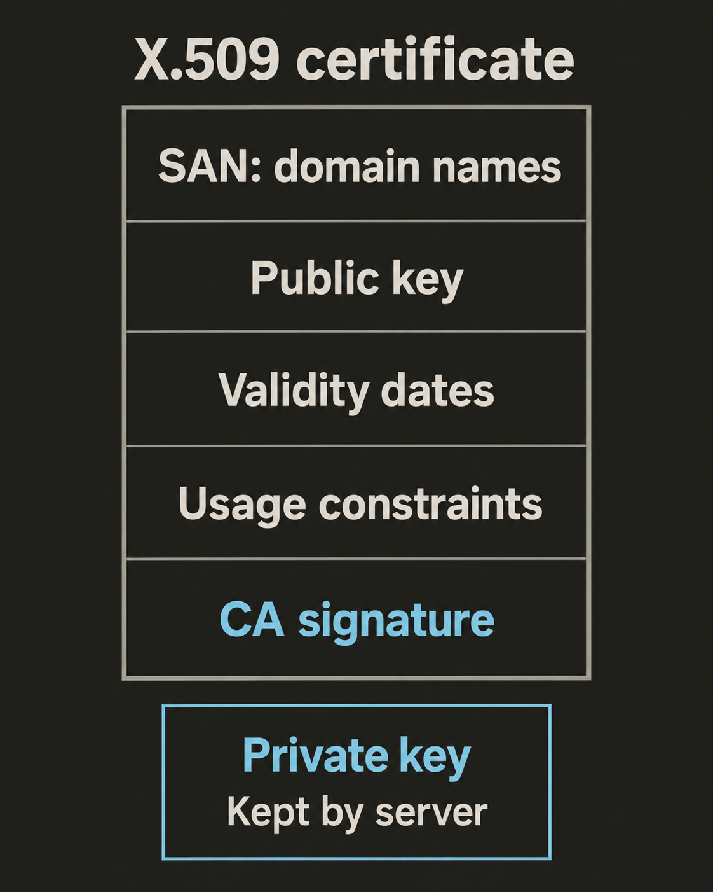

`X.509` определяет структуру сертификатов, которые используются в HTTPS. Сертификат содержит общедоступные сведения и цифровую подпись. Соответствующего закрытого ключа в нём никогда нет. Собственный сертификат сервера часто называют `конечным сертификатом (leaf certificate)`, чтобы отличать его от сертификатов выдавшего его центра.

## Прочитайте настоящий сертификат

Для этого упражнения на macOS нужен OpenSSL v3+. Выполните команды в каталоге для практики: они создадут файл `server.pem`. Первой команде требуется подключение к интернету.

```sh
openssl s_client -connect example.com:443 \
  -servername example.com -showcerts </dev/null \
  | openssl x509 -out server.pem
```

`s_client` открывает TLS-соединение. Параметр `-servername` передаёт имя нужного хоста через `Server Name Indication (SNI)`. Это помогает серверу, на котором размещено несколько сайтов, выбрать нужный сертификат. `-showcerts` выводит сертификаты, полученные от сервера. `x509` читает первый из них и сохраняет в формате PEM.

Команда получает сертификат для изучения. Это ещё не доказывает, что браузер доверял бы соединению. По умолчанию `s_client` может продолжить работу после ошибок проверки сертификата, а эта команда не запрашивает проверку имени хоста. [Документация OpenSSL описывает такое поведение диагностического инструмента](https://docs.openssl.org/3.0/man1/openssl-s_client/#notes).

Выведите краткие сведения, а затем всё содержимое:

```sh
openssl x509 -in server.pem -noout -subject -issuer -serial -dates
openssl x509 -in server.pem -noout -text
```

`-noout` скрывает сертификат в закодированном виде. `-text` показывает его поля и расширения. Сертификат `example.com` со временем меняется, поэтому ориентируйтесь на свой текущий вывод, а не на фиксированные значения. Параметры описаны в [справочнике OpenSSL по выводу полей сертификата](https://docs.openssl.org/3.0/man1/openssl-x509/#certificate-printing-options).

## Отличайте владельца от издателя

Найдите в выводе следующие поля:

| Поле | Значение |
| --- | --- |
| `Subject` | Указывает, кому принадлежит открытый ключ сертификата. Может содержать общее имя или название организации. |
| `Issuer` | Называет того, кто подписал сертификат: обычно это `центр сертификации (CA)`. Само имя ещё не доказывает доверия. |
| `Serial Number` | Идентифицирует сертификат среди сертификатов этого издателя. Сам по себе не является глобально уникальным идентификатором. |
| `Not Before` | Начало срока действия. |
| `Not After` | Конец срока действия. |

Даты срока действия указаны в UTC. OpenSSL обычно выводит их с обозначением `GMT`, поэтому не считайте их местным временем вашего Mac. Клиент проверяет, попадает ли его текущее время в этот интервал. См. [описание полей сертификата X.509 в RFC 5280](https://www.rfc-editor.org/rfc/rfc5280.html#section-4.1.2).

## Найдите имена, на которые распространяется сертификат

`Subject Alternative Name (SAN)` — расширение со списком идентификаторов, на которые распространяется сертификат. Для сайта ищите записи `DNS:`. Современная проверка имени хоста в HTTPS использует SAN, без обращения к `Common Name (CN)` в поле Subject. Совпадающее CN не исправит отсутствующий или неверный SAN.

Выведите только SAN:

```sh
openssl x509 -in server.pem -noout -ext subjectAltName
```

`Wildcard` заменяет ровно одну целую крайнюю левую метку DNS-имени. Например, `*.example.com` подходит для `api.example.com` и `www.example.com`. Он не подходит ни для `example.com`, ни для `v2.api.example.com`. Для самого домена нужна отдельная запись SAN. Имена не содержат путь URL или порт. Если в HTTPS URL указан IP-адрес, ему должна соответствовать запись SAN типа `IP Address`, а не DNS. Эти правила приведены в [стандарте проверки подлинности сервиса в TLS](https://www.rfc-editor.org/rfc/rfc9525.html#section-6).

## Различайте ключ и подпись

`Subject Public Key Info (SPKI)` содержит открытый ключ владельца, его алгоритм и необходимые параметры. В полном выводе найдите `Public Key Algorithm` внутри этого раздела. У ключей RSA и ключей на эллиптических кривых параметры различаются.

`Signature Algorithm` описывает, как издатель подписал этот сертификат. Это другая операция. Центр сертификации может подписать ключом RSA сертификат, содержащий открытый ключ на эллиптической кривой. Названия двух алгоритмов не обязаны совпадать.

Подпись сертификата защищает подписанные поля от изменений. Её проверяют открытым ключом издателя. Это отдельная подпись, отличная от той, которую сервер создаёт своим закрытым ключом во время TLS handshake. См. RFC 5280: [алгоритмы подписи](https://www.rfc-editor.org/rfc/rfc5280.html#section-4.1.1.2) и [SPKI](https://www.rfc-editor.org/rfc/rfc5280.html#section-4.1.2.7).

## Прочитайте ограничения использования

Расширения также ограничивают, для чего можно использовать сертификат:

- `Basic Constraints` со значением `CA:FALSE` указывает, что сертификат не может служить сертификатом центра сертификации. Конечный сертификат сайта не позволяет выпускать другие сертификаты.
- `Extended Key Usage (EKU)` перечисляет допустимые назначения. `TLS Web Server Authentication`, также обозначаемое `serverAuth`, разрешает проверку подлинности сервера. `clientAuth` — отдельное назначение для проверки подлинности клиентов.
- `Key Usage` ограничивает криптографические операции, например `Digital Signature`. Его учитывают вместе с EKU.

Совпадение имени хоста и действующий срок не отменяют этих ограничений. Названия полей описаны в [справочнике OpenSSL по расширениям](https://docs.openssl.org/3.0/man5/x509v3_config/#standard-extensions).



## Различайте PEM и DER

`DER` — бинарная кодировка. `PEM` хранит закодированные данные как текст Base64 между границами с метками. Сертификат PEM начинается с `-----BEGIN CERTIFICATE-----` и заканчивается `-----END CERTIFICATE-----`. Кодировка меняет способ хранения сертификата, но не его смысл. См. [RFC 7468 о кодировании сертификатов](https://www.rfc-editor.org/rfc/rfc7468.html#section-5).

Расширения `.crt`, `.cer` и `.pem` не гарантируют формат файла. Файл PEM может содержать несколько блоков: например, отдельные сертификаты или закрытый ключ. Блок закрытого ключа — самостоятельный объект, а не часть сертификата.

Если известно, что сертификат имеет формат DER, укажите формат входных данных:

```sh
openssl x509 -inform DER -in server.der -noout -text
```

## Практика

Изучите `server.pem`. Найдите имена в SAN, время окончания срока действия в UTC, алгоритм открытого ключа владельца и алгоритм подписи сертификата.

Затем рассмотрите условный сертификат, единственная DNS-запись SAN которого — `*.example.com`. Какие имена подходят: `shop.example.com`, `example.com` или `admin.shop.example.com`?

**Ответ:** подходит только `shop.example.com`. Wildcard заменяет ровно одну метку. Это устанавливает совпадение имени; доверие, срок действия и допустимое использование ещё нужно проверить отдельно.
