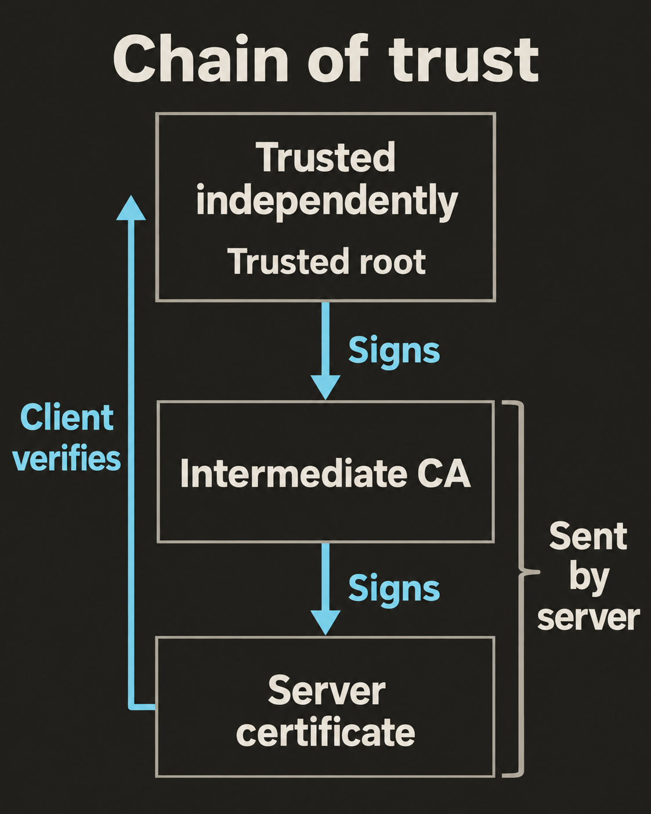

Сертификат содержит открытый ключ и доменные имена. Подпись позволяет установить, кто подписал эти сведения. Но браузеру ещё нужно решить, доверять ли подписавшей стороне. Для этого он проверяет `цепочку доверия`: последовательность сертификатов, которая связывает сервер с организацией, уже пользующейся доверием клиента.

## От сервера до доверенного корня

`Центр сертификации (CA)` подписывает сертификаты. В типичной цепочке HTTPS есть три роли:

- `Конечный сертификат (leaf certificate)` удостоверяет сервер, например `api.example.com`. Он содержит открытый ключ сервера.
- `Промежуточный сертификат` принадлежит центру сертификации, который подписывает конечный сертификат. Промежуточных уровней может быть несколько.
- `Корневой сертификат` представляет организацию, которую клиент принимает как исходную точку доверия.

Браузер проверяет подпись конечного сертификата открытым ключом из промежуточного. Подпись промежуточного сертификата он проверяет открытым ключом из корневого. Совпадения имён издателей недостаточно: подписи должны пройти проверку.

Корень служит `якорем доверия (trust anchor)` — источником доверия, принятым независимо от этого соединения. Корневые сертификаты обычно `самоподписанные`: подпись создаётся их собственным закрытым ключом. Сама по себе эта подпись не создаёт доверия. Клиент принимает корень, потому что поставщик его ПО или администратор установил доверие отдельно. Если сервер отправит неизвестный корневой сертификат вместе со своим, корень не станет доверенным. [RFC 5280 описывает этот независимый выбор источника доверия.](https://www.rfc-editor.org/rfc/rfc5280.html#section-6.1.1)

## Что отправляет сервер

Сервер сначала отправляет конечный сертификат, а затем промежуточные сертификаты, необходимые для цепочки. Каждый промежуточный сертификат должен удостоверять сертификат перед ним. Корень обычно не отправляют: якорь доверия уже есть у клиента. Такой формат цепочки описан в [TLS 1.3](https://www.rfc-editor.org/info/rfc9846/).

Рассмотрим условную конфигурацию:

1. Сервер отправляет конечный сертификат для `api.example.com`, подписанный `Intermediate I`.
2. Затем он отправляет `Intermediate I`, подписанный `Root R`.
3. Браузер независимо доверяет `Root R` и может построить путь.

Если сервер отправит только конечный сертификат, у клиента может не оказаться открытого ключа промежуточного центра. Некоторые клиенты умеют загружать недостающие промежуточные сертификаты или брать их из кеша. Поэтому неполная конфигурация сервера иногда остаётся незаметной. Не стоит рассчитывать, что любой клиент заполнит пробел; [тесты проверки сертификатов в Chromium](https://chromium.googlesource.com/chromium/src/+/refs/heads/main/net/cert/cert_verify_proc_unittest.cc) охватывают и успешную, и неудачную загрузку.

## Что проверяют помимо подписей

Построить путь — лишь часть проверки. Браузер также проверяет:

- **Право выпускать сертификаты.** Промежуточные сертификаты должны разрешать подписание других сертификатов. Расширение `Basic Constraints` указывает статус центра сертификации значением `CA:TRUE`. Ограничения длины цепочки и допустимых имён тоже должны соблюдаться.
- **Срок действия.** Конечный и промежуточные сертификаты должны быть действующими. При проверке используется текущее время клиента.
- **Назначение и стойкость.** Расширение Key Usage должно разрешать нужную операцию TLS. Extended Key Usage должно разрешать проверку подлинности сервера, если это ограничение присутствует. Ключи и алгоритмы подписи должны отвечать политике безопасности клиента.
- **Критические расширения.** Клиент должен отвергнуть сертификат, если не может обработать обязательное критическое расширение.

Эти проверки следуют правилам [проверки пути X.509](https://www.rfc-editor.org/rfc/rfc5280.html#section-6), которые дополняются [правилами браузера](https://chromium.googlesource.com/chromium/src/+/main/net/data/ssl/chrome_root_store/faq.md).

Отдельно браузер сверяет запрошенное имя хоста с `Subject Alternative Name (SAN)` конечного сертификата. Для `https://api.example.com` сертификат, содержащий только `www.example.com`, не подойдёт даже при доверенной цепочке. Если DNS разрешает оба имени в один IP-адрес, это ничего не меняет. Ожидаемое имя берётся из URL, а не из сертификата или псевдонима DNS. [RFC 9525 определяет правила сопоставления имён сервиса.](https://www.rfc-editor.org/rfc/rfc9525.html#section-6)

## Доверие зависит от клиента

`Хранилище доверия (trust store)` содержит принятые клиентом якоря доверия. На macOS браузеры и другие приложения могут использовать разные хранилища и политики. У Chrome есть собственное корневое хранилище; Apple предоставляет доверенные корни для системной проверки доверия. Успешная проверка в одном приложении не гарантирует успеха в другом. Подробнее — в [FAQ корневого хранилища Chrome](https://chromium.googlesource.com/chromium/src/+/main/net/data/ssl/chrome_root_store/faq.md) и [обзоре доверия к сертификатам Apple](https://support.apple.com/guide/deployment/depb5eff8914/web).

Частный центр сертификации может обслуживать внутренние приложения, если их клиенты независимо доверяют ему. Правильная подпись недоверенного самоподписанного серверного сертификата сама по себе не даёт принятого якоря доверия.

## Дополнительные правила браузеров

Браузеры могут требовать `Certificate Transparency (CT)` — свидетельство того, что сертификат, выпущенный публично доверенным центром, был передан в публичные журналы. Это делает выпуск сертификатов наблюдаемым. CT не заменяет доверенную цепочку и проверку имени хоста. [Документация Chrome по CT](https://chromium.googlesource.com/chromium/src/+/main/net/docs/certificate-transparency.md) описывает область применения этих правил.

`Отзыв` делает сертификат недействительным до истечения его срока действия. Клиенты применяют разные правила проверки отзыва и используют разные источники сведений о статусе. Не следует считать, что каждый браузер при каждом соединении запрашивает свежий статус по сети. [FAQ Chrome](https://chromium.googlesource.com/chromium/src/+/main/net/data/ssl/chrome_root_store/faq.md) описывает его подход.

## Проверьте свои рассуждения

Допустим, сроки действия, ограничения и правила браузера соблюдены. Браузер доверяет `Root R`. Сервер отправляет конечный сертификат для `api.example.com` и `Root R`, но пропускает `Intermediate I`. В кеше браузера нет промежуточного сертификата, и загрузить его невозможно.

Сможет ли браузер проверить цепочку? Поможет ли отправка дополнительных копий корневого сертификата?

**Ответ:** нет. Конечный сертификат подписан `Intermediate I`, а не `Root R`. Промежуточного сертификата нет, поэтому в пути проверки подписи остаётся пробел. Отправка конечного сертификата вместе с правильным промежуточным устраняет этот пробел. Однако открытие `https://www.example.com` всё равно завершится ошибкой, если конечный сертификат покрывает только `api.example.com`.
