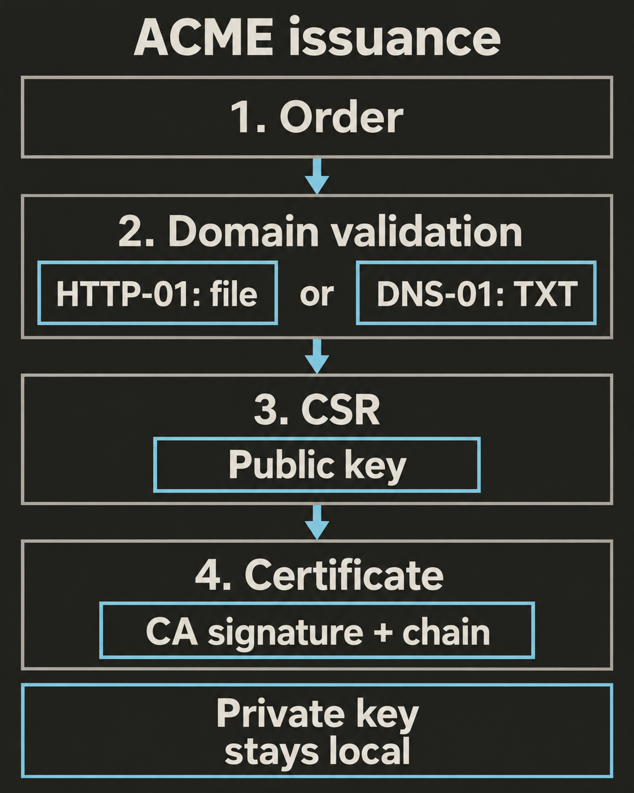

A trusted chain tells the browser who signed a certificate. Before signing, the certificate authority must check that the applicant is authorized to request the names in it. Issuance connects that authorization to a public key.

## Prepare the key and request

The operator or managed hosting service generates a certificate key pair. Keep the private key under the control of the server or service that accepts TLS connections. The CA needs the public key, never the private key.

A `certificate signing request (CSR)` is a signed request for a certificate. For HTTPS, it carries the public key and requested SAN names. The corresponding private key signs the request. This proves possession of that key; it does not prove control of any domain.

The CA verifies the request and performs its identity checks. It then builds the certificate, chooses its validity period and serial number, and signs it with the CA's own private key. The CSR signature and the certificate signature come from different keys. See [PKCS #10 request structure](https://www.rfc-editor.org/rfc/rfc2986.html#section-3) and [Let's Encrypt's issuance explanation](https://letsencrypt.org/how-it-works/).

## Understand what the CA validates

These labels describe the checks made before issuance:

- `Domain Validation (DV)` verifies control of the requested domain names. It does not verify a company's identity.
- `Organization Validation (OV)` also verifies the identity of the organization named in the certificate.
- `Extended Validation (EV)` adds more detailed checks of that organization's identity and authority to apply.

[DigiCert describes these validation levels](https://www.digicert.com/difference-between-dv-ov-and-ev-ssl-certificates). They change the identity information checked by the CA. They do not select stronger TLS traffic encryption. The algorithms and keys used by the connection determine that strength, as described by [TLS 1.3](https://www.rfc-editor.org/info/rfc9846/).

## Automate issuance with ACME

`ACME` (Automatic Certificate Management Environment) is a protocol for automating certificate requests and domain validation. Let's Encrypt uses it. An ACME client can run on your server or inside a managed service.

The client has an `account key` for authenticating requests to the CA. This must be separate from the certificate key used by your TLS server. [ACME specifies this separation](https://www.rfc-editor.org/rfc/rfc8555.html#section-11.1).

A typical new issuance follows four steps:

1. The client creates an `order` listing the required domain names.
2. The CA offers `challenges`: tasks that demonstrate control of those names. The client prepares the responses and asks the CA to check them.
3. Once the required authorizations are valid, the client sends the CSR to finalize the order. Its requested names must match the order.
4. The CA issues the certificate. The client downloads it with the intermediate chain.

The account key authenticates the ACME exchange. The certificate key signs the CSR and later authenticates the TLS server. Domain validation is a separate check. [RFC 8555 describes the order flow](https://www.rfc-editor.org/rfc/rfc8555.html#section-7.4).

## Follow an HTTP-01 challenge

Consider an imaginary request for `api.example.com`. This is a walkthrough, not a domain you can use for your own issuance.

With `HTTP-01`, the client serves a value at a specific HTTP path:

1. The CA supplies a fresh token.
2. The client prepares the response from the token and a fingerprint of its account public key.
3. It serves that response at `http://api.example.com/.well-known/acme-challenge/<TOKEN>`.
4. The CA fetches the URL and checks the response before authorizing issuance.

The initial request uses port `80`; choosing another port is not allowed. The path must reach the challenge handler through your proxy or load balancer. If several servers can answer, each must serve the correct response. HTTP-01 cannot validate a wildcard name. [Let's Encrypt documents HTTP-01](https://letsencrypt.org/docs/challenge-types/#http-01-challenge).

## Use DNS-01 when HTTP is unsuitable

With `DNS-01`, the client publishes a DNS TXT record at `_acme-challenge.api.example.com`. Its value is a hash derived from the token and account public key, not the token alone. The CA checks public DNS for the expected value.

DNS-01 can validate `*.example.com`; its challenge record is at `_acme-challenge.example.com`. The web server does not need public access, but the DNS response must be publicly visible. Wait for DNS changes to become visible before requesting validation. For automation, use DNS API credentials with the narrowest available permissions. [Let's Encrypt documents DNS-01 and credential handling](https://letsencrypt.org/docs/challenge-types/#dns-01-challenge).

Public CAs do not issue certificates for `localhost` or private names such as `app.test`. Local development can use a private CA that your own clients trust. This follows the [public certificate naming rules](https://cabforum.org/working-groups/server/baseline-requirements/documents/CA-Browser-Forum-TLS-BR-2.3.1.pdf) and [Let's Encrypt's localhost guidance](https://letsencrypt.org/docs/certificates-for-localhost/).

## Check issuer authorization

`Certification Authority Authorization (CAA)` is a DNS record that can restrict which CAs may issue certificates for a domain. A successful challenge does not override a CAA restriction. CAA controls issuance; it does not change a browser's trust store. [Let's Encrypt explains CAA](https://letsencrypt.org/docs/caa/).

## Check your understanding

Your API is private, but you control public DNS for its registered domain. You need a wildcard certificate. Which challenge fits, and should you send the CA your private key?

**Answer:** DNS-01 fits: publish the required TXT response in public DNS. HTTP-01 does not support wildcards and requires a publicly reachable HTTP handler. Send the signed CSR containing the public key. Keep the matching private key under your control.
