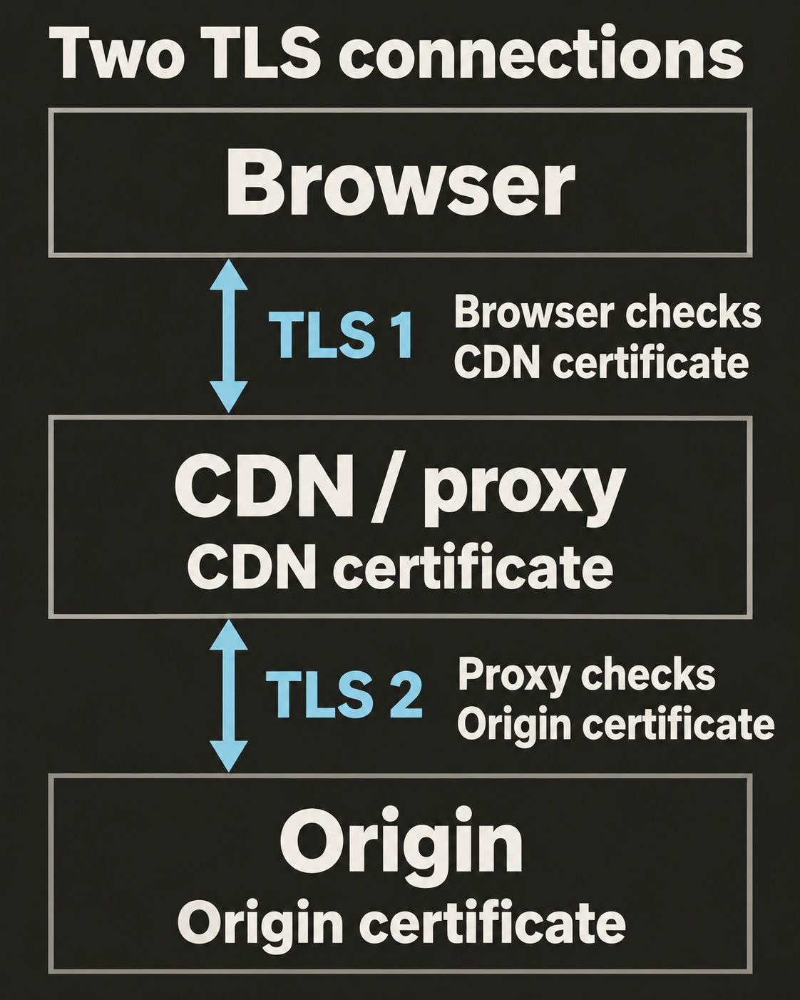

Сертификат для вашего сервиса уже выпущен. Теперь его нужно передать компоненту, который обрабатывает TLS-соединение клиента. Размещать сертификат рядом с кодом приложения имеет смысл, только если именно приложение обрабатывает TLS.

## Найдите точку завершения TLS

`Завершение TLS (TLS termination)` — выполнение TLS handshake и расшифровка трафика на конечной стороне соединения. Этой стороне нужен доступ к сертификату и соответствующему закрытому ключу.

В небольшой системе TLS может завершать само приложение. В более крупной — CDN, балансировщик нагрузки или `обратный прокси (reverse proxy)`. Обратный прокси принимает запросы клиентов и пересылает их приложению. Браузер видит сертификат, который предъявляет этот внешний компонент.

Например, браузер подключается к CDN по HTTPS. Затем CDN подключается к вашему приложению. Это два отдельных соединения. Если второе тоже использует TLS, CDN должен проверить сертификат приложения и имя хоста для этого соединения. Действующий сертификат на стороне браузера не подтверждает подлинность сервера за CDN. [NGINX описывает отдельные настройки проверки TLS для соединения с сервером за прокси](https://nginx.org/en/docs/http/ngx_http_proxy_module.html#proxy_ssl_verify).



## Подготовьте сертификат и ключ

Типичные файлы PEM выполняют следующие роли:

| Файл | Содержимое |
| --- | --- |
| `cert.pem` | Конечный сертификат сервиса. |
| `fullchain.pem` | Конечный сертификат, за которым следуют промежуточные сертификаты для его цепочки. |
| `privkey.pem` | Соответствующий закрытый ключ. |

Это условные имена, а не особые типы файлов. Ваш поставщик может использовать другие названия. Файл цепочки начинается с конечного сертификата. Каждый следующий промежуточный сертификат удостоверяет предыдущий. Корневой сертификат обычно не включают: клиенты устанавливают доверие к нему отдельно. [Node.js определяет такой порядок для параметра `cert`](https://nodejs.org/docs/latest-v22.x/api/tls.html#tlscreatesecurecontextoptions).

Сертификаты могут быть общедоступными. Закрытый ключ нужно хранить в секрете. Предоставляйте доступ только тем процессам и сотрудникам, которым он необходим. Не помещайте ключ в Git, сборки фронтенда или журналы. Используйте хранилище секретов и средства управления доступом вашей платформы развёртывания. [Рекомендации NGINX по HTTPS также разделяют доступ к сертификату и закрытому ключу](https://nginx.org/en/docs/http/configuring_https_servers.html#configuration).

## Проверьте соответствие ключа

Прежде чем загружать файлы, сравните открытый ключ сертификата с открытой частью закрытого ключа. На macOS с OpenSSL v3+ выполните команды в каталоге с выпущенными файлами:

```sh
openssl x509 -in cert.pem -pubkey -noout > certificate-public.pem
openssl pkey -in privkey.pem -pubout > key-public.pem
cmp certificate-public.pem key-public.pem
```

Обе команды OpenSSL должны завершиться успешно. После этого `cmp` при совпадении файлов завершается без вывода. Если файлы различаются, остановитесь и найдите правильную пару. Этот способ работает с RSA и ключами на эллиптических кривых: он не сравнивает модуль, присущий только RSA. В файлы записываются только открытые ключи. См. справочники OpenSSL: [`x509 -pubkey`](https://docs.openssl.org/3.5/man1/openssl-x509/#certificate-printing-options) и [`pkey -pubout`](https://docs.openssl.org/3.5/man1/openssl-pkey/#options).

Совпадение ключей ещё не означает, что браузер доверяет сертификату. Имена, сроки действия и цепочка сертификатов по-прежнему должны пройти проверки из предыдущих уроков.

## Загрузите файлы в Node.js

Для этого примера на macOS нужен Node.js v22+. Предполагается, что у вас уже есть `fullchain.pem` и незашифрованный `privkey.pem` для локальной разработки. Сертификат должен подходить для `localhost`, а браузер — уже доверять выдавшему его локальному центру сертификации. Сертификат для рабочего домена обычно не подходит для `localhost`.

Сохраните код как `server.mjs` в том же каталоге:

```js
import { createServer } from 'node:https';
import { readFileSync } from 'node:fs';

const credentials = {
  key: readFileSync('privkey.pem'),
  cert: readFileSync('fullchain.pem'),
};

createServer(credentials, (req, res) => {
  res.writeHead(200, { 'content-type': 'text/plain; charset=utf-8' });
  res.end('HTTPS is working.\n');
}).listen(8443, '127.0.0.1', () => {
  console.log('Listening at https://localhost:8443');
});
```

Запустите его из этого каталога:

```sh
node server.mjs
```

Откройте `https://localhost:8443` в браузере. Сервер принимает соединения только на IPv4-адресе loopback вашего Mac. Node загружает ключ и цепочку при запуске процесса. Во время handshake он предъявляет цепочку и доказывает владение закрытым ключом. Обработчик запроса запускается после установления TLS. [Справочник Node.js по HTTPS объясняет `createServer`](https://nodejs.org/download/release/latest-v22.x/docs/api/https.html#httpscreateserveroptions-requestlistener).

## Выберите сертификат до маршрутизации HTTP

Несколько доменов могут использовать один IP-адрес. `Server Name Indication (SNI)` передаёт имя нужного хоста во время TLS handshake. Сервер может выбрать по нему сертификат ещё до получения HTTP-запроса. Выбор маршрута по HTTP-заголовку `Host` происходит позже. [RFC 6066 определяет SNI и выбор сертификата](https://www.rfc-editor.org/rfc/rfc6066.html#section-3).

SNI не заменяет проверку имени хоста. Браузер всё равно сравнивает SAN выбранного сертификата с запрошенным именем. Правильная настройка SNI с неподходящим сертификатом всё равно приведёт к ошибке.

## Практика

CDN завершает TLS-соединение браузера и пересылает запросы вашему приложению Node.js по HTTPS. Вы заменили сертификат приложения, но браузеры по-прежнему сообщают об истёкшем сроке действия сертификата. Где искать причину?

**Ответ:** проверьте сертификат, который предъявляет CDN. Именно CDN завершает TLS-соединение браузера. Сертификат приложения относится к отдельному соединению с сервером за CDN. Проверьте и его, используя правила доверия и проверки имени хоста, настроенные в CDN. В следующем уроке разберём, как поддерживать сертификаты действующими.
