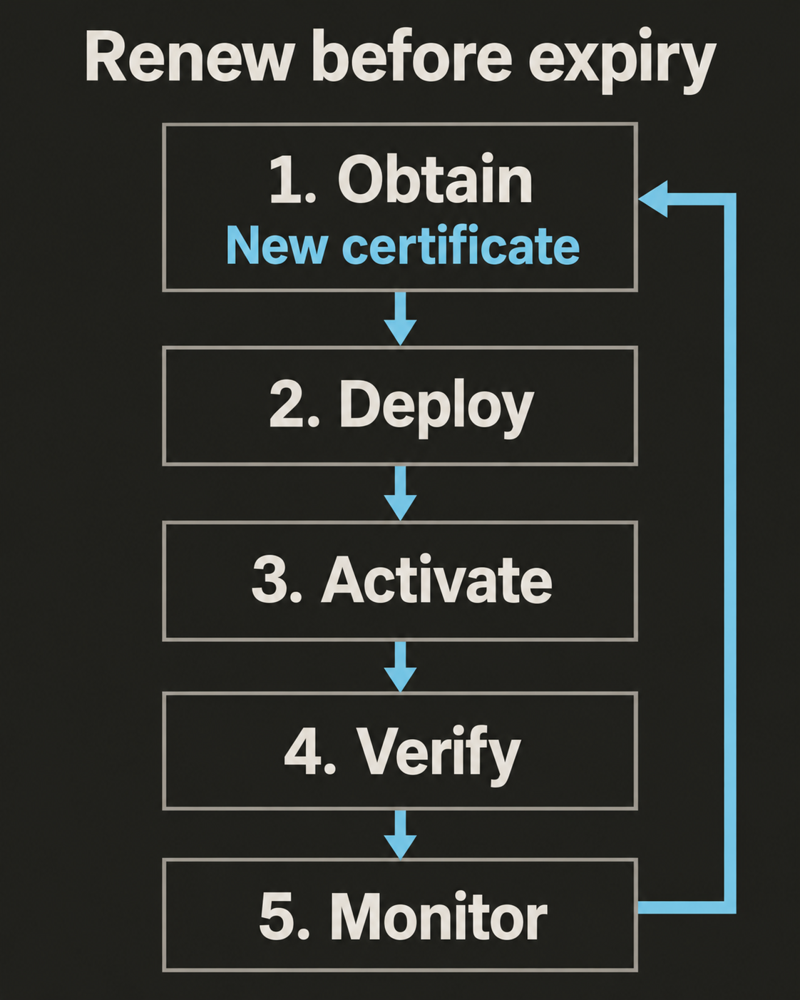

Сегодня сертификат работает, а через неделю соединение может перестать устанавливаться, хотя приложение не менялось. У сертификата ограниченный срок действия. Чтобы HTTPS продолжал работать, выпуск, развёртывание и следующую замену нужно рассматривать как единый процесс.

## Разберитесь в сроке действия

`Срок действия` сертификата задают поля `notBefore` и `notAfter`. Это время в UTC. При проверке сертификата клиент сопоставляет своё текущее время с этим интервалом. Из-за неверных часов сертификат может казаться просроченным или ещё не вступившим в силу. [RFC 5280 определяет эти даты](https://www.rfc-editor.org/rfc/rfc5280.html#section-4.1.2.5).

Истечение срока не удаляет закрытый ключ и не меняет байты сертификата. Сертификат просто перестаёт проходить проверку даты. Читайте реальные значения полей: у разных сертификатов срок действия может различаться.

## Отличайте обновление от смены ключей

`Обновление` — это получение нового сертификата взамен старого. Даты старого сертификата при этом не продлеваются. Они защищены подписью CA, поэтому изменение дат нарушило бы подпись. У нового сертификата собственные срок действия и серийный номер.

`Смена ключей` означает замену самой ключевой пары. При обычном обновлении можно сохранить существующий ключ или создать новый — это зависит от настроек клиента и принятой политики. Например, [Certbot поддерживает оба варианта](https://eff-certbot.readthedocs.io/en/stable/using.html#certbot-command-line-options). Проверьте, какой из них использует ваша автоматизация.

Новый сертификат с прежним открытым ключом не устраняет последствия утечки закрытого ключа. Соответствующий секрет остаётся у злоумышленника.

## Планируйте замену до истечения срока

Регулярно запускайте автоматизацию сертификатов и оставляйте время на повторные попытки и сбои развёртывания. Избегайте фиксированного правила вроде «обновлять раз в два месяца»: сроки действия сертификатов могут меняться.

`ACME Renewal Information (ARI)` позволяет центру сертификации рекомендовать интервал обновления конкретного сертификата. Если ARI поддерживают и CA, и клиент, клиент запрашивает актуальные рекомендации и выбирает момент обновления внутри этого интервала. CA может предложить раннее обновление перед запланированным отзывом. [RFC 9773 определяет ARI](https://www.rfc-editor.org/rfc/rfc9773.html).

Сохраняйте резервное расписание, основанное на реальном сроке действия сертификата. Запросы ARI могут завершаться ошибкой, а некоторые клиенты и CA не поддерживают ARI. [Руководство Let's Encrypt по интеграции](https://letsencrypt.org/docs/integration-guide/#when-to-renew) описывает планирование и повторные попытки.

## Завершайте обновление там, где принимают TLS

Считайте обновление завершённым, только когда клиенты получают новый сертификат:

1. **Получите его.** Клиент ACME запрашивает и загружает новый сертификат и цепочку промежуточных сертификатов. Если потребуется проверка домена, она по-прежнему должна работать.
2. **Разверните его.** Разместите сертификат, цепочку и соответствующий закрытый ключ во всех точках завершения TLS, включая прокси и управляемые сервисы.
3. **Активируйте его.** Добейтесь, чтобы каждый сервис загрузил новый сертификат. Одни сервисы делают это автоматически; другим нужна перезагрузка конфигурации или обновление через интерфейс управления.
4. **Проверьте его.** Установите новые TLS-соединения с нужным именем хоста. Проверьте полученный сертификат, его имена, срок действия и цепочку. Охватите все реплики и регионы: одно успешное соединение может скрыть сервер со старым сертификатом.
5. **Следите за ним.** Настройте оповещения о сбоях выпуска и развёртывания и об остатке срока действия сертификата, который действительно получают клиенты. Оставьте достаточно времени на устранение проблемы.

Например, в Certbot есть [обработчики развёртывания, которые запускаются после успешного обновления](https://eff-certbot.readthedocs.io/en/stable/using.html#renewing-certificates). Само появление нового файла ещё не доказывает, что работающий сервер его загрузил.

## Отзывайте небезопасные сертификаты

`Отзыв` — это заявление CA о том, что сертификату больше нельзя доверять, хотя его срок ещё не истёк. Отзыв может потребоваться из-за утечки закрытого ключа или ошибки при выпуске. Запрашивайте его способом, который поддерживает CA; обычно запрос может выполнить клиент ACME. [Let's Encrypt описывает, кто и как вправе запросить отзыв](https://letsencrypt.org/docs/revoking/).

Если закрытый ключ сертификата стал доступен посторонним, действуйте без промедления:

- Восстановите безопасный контроль над затронутыми системами, чтобы новый ключ оставался в секрете.
- Создайте новую ключевую пару и получите сертификат для её открытого ключа.
- Разверните и проверьте новый сертификат во всех затронутых точках завершения TLS.
- Запросите отзыв всех ещё действующих сертификатов, использующих скомпрометированный ключ. Не ждите обычного истечения срока.

Удаление файла из репозитория не делает его содержимое снова секретным. Замена сертификата на вашем сервере тоже не лишает силы копию, которой располагает злоумышленник.

## Разберитесь, как клиенты узнают об отзыве

`Certificate Revocation List (CRL)` — подписанный список отозванных сертификатов. `Online Certificate Status Protocol (OCSP)` предоставляет подписанные ответы о статусе указанных сертификатов. Это разные способы публикации статуса; их описывают [RFC 5280](https://www.rfc-editor.org/rfc/rfc5280.html#section-3.3) и [RFC 6960](https://www.rfc-editor.org/rfc/rfc6960.html#section-2).

Клиенты используют разные политики, кеши и источники статуса, в том числе списки, распространяемые поставщиками браузеров. Отзыв не блокирует сертификат мгновенно во всех клиентах. Не следует считать, что при каждом соединении браузер отправляет свежий запрос OCSP. [FAQ Chrome объясняет его подход к отзыву](https://chromium.googlesource.com/chromium/src/+/main/net/data/ssl/chrome_root_store/faq.md).

Поддержка различается и между CA. Let's Encrypt [отключил сервис OCSP в августе 2025 года](https://letsencrypt.org/2025/08/06/ocsp-service-has-reached-end-of-life) и публикует сведения об отзыве через CRL.

## Проверьте процесс

Два фронтенда обслуживают `api.example.com`. Старый сертификат истекает через шесть дней. Автоматизация получает новый сертификат и копирует его на оба фронтенда. Первый загружает его, но второй продолжает предъявлять старый сертификат. Задание выпуска сообщает об успехе. Завершено ли обновление? Что меняется, если старый закрытый ключ ещё и попал в публичный репозиторий?

**Ответ:** обновление не завершено. Проверьте оба фронтенда через новые TLS-соединения и активируйте новый сертификат на том, где остался старый. Следите за сертификатом, который получают клиенты, а не только за заданием выпуска. Если ключ утёк, используйте новую ключевую пару, разверните её сертификат повсюду и без промедления отзовите затронутые сертификаты со старым ключом. Обычное обновление с сохранением утёкшего ключа оставит злоумышленнику возможность подтверждать подлинность этим ключом.
